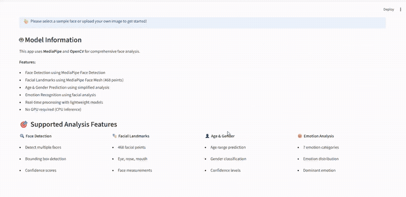
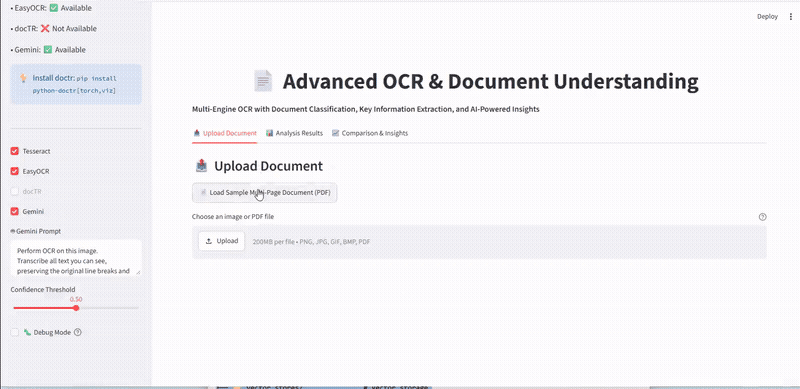

# 🧠 AI Systems & Production Prototypes

[](https://opensource.org/licenses/MIT)
[](https://www.python.org/downloads/)
[](https://streamlit.io)
[](https://developers.google.com/mediapipe)

> A monorepo of production-grade AI prototypes, real-time computer vision engines, multimodal document extraction pipelines, and agentic workflows built by **[Ramchandra Babar](https://ram-portfolio-green.vercel.app/)**.

---

## 🚀 Systems Showcase

| Subsystem | Core Stack | Primary Metric / Capability | Live Preview | Directory |
| :--- | :--- | :--- | :---: | :--- |
| **Real-Time 468-Point Face Mesh** | MediaPipe, OpenCV, Streamlit | 468 dense 3D landmarks, iris gaze tracking, `<15ms` latency | [View Demo](#1-real-time-468-point-face-mesh) | [`apps/face-mesh-analytics`](apps/face-mesh-analytics/) |
| **Multimodal Document OCR & Understanding** | Tesseract, PyMuPDF, EasyOCR | Layout detection, table transcription & key-value schema extraction | [View Demo](#2-multimodal-document-ocr) | [`apps/multimodal-ocr-engine`](apps/multimodal-ocr-engine/) |
| **Agentic Research Assistant (RAG)** | Python Agent Harness, Tavily, Vector Store | Multi-step query planning, web scraping & grounded citation synthesis | [View Demo](#3-agentic-research-rag) | [`apps/agentic-research-rag`](apps/agentic-research-rag/) |

---

## 1. Real-Time 468-Point Face Mesh & Biometric Geometry



- **Capabilities**: Sub-millimeter 3D facial coordinate mapping, landmark tessellation, iris tracking, and spatial confidence analytics.
- **Inference Mode**: Real-time CPU-optimized pipeline running at 30+ FPS.
- **Deep-Dive**: See [`apps/face-mesh-analytics/README.md`](apps/face-mesh-analytics/README.md).

---

## 2. Multimodal Document OCR & Understanding



Extracts clean tabular data, structured entities, and key-value pairs from complex multi-page invoices, ID cards, and scanned PDFs using multiple blended OCR backends with spatial coordinate bounding boxes.

- **Capabilities**: PyMuPDF vectorized PDF parsing + Tesseract/EasyOCR fallback with image threshold pre-processing.
- **Deep-Dive**: See [`apps/multimodal-ocr-engine/README.md`](apps/multimodal-ocr-engine/README.md).

---

## 3. Agentic Research Assistant & Grounded RAG


A deterministic multi-step agent harness that decomposes user research queries into search tasks, scrapes authoritative sources, detects hallucinations, and streams factual markdown reports with verifiable citations.

- **Deep-Dive**: See [`apps/agentic-research-rag/README.md`](apps/agentic-research-rag/README.md).

---

## 🛠️ Repository Architecture

```
ai-systems-prototypes/
├── apps/
│   ├── face-mesh-analytics/         # 468-point face mesh & iris tracking
│   │   ├── assets/demo.gif
│   │   ├── app.py
│   │   └── requirements.txt
│   ├── multimodal-ocr-engine/       # Multi-engine OCR & PDF parser
│   │   ├── assets/
│   │   ├── app.py
│   │   └── requirements.txt
│   └── agentic-research-rag/        # Autonomous research agent & web search
│       ├── assets/
│       ├── app.py
│       └── requirements.txt
├── docs/
│   └── demos/                       # Unified demo GIFs & architectural diagrams
├── .gitignore
└── README.md
```

---

## 👤 Author & Contact

**Ramchandra Babar**  
*AI Engineer & Data Science Specialist*  
- 🌐 **Portfolio**: [ram-portfolio-green.vercel.app](https://ram-portfolio-green.vercel.app/)  
- 💼 **LinkedIn**: [linkedin.com/in/rambabar](https://www.linkedin.com/in/rambabar)  
- 🐙 **GitHub**: [@rambabar](https://github.com/rambabar)
