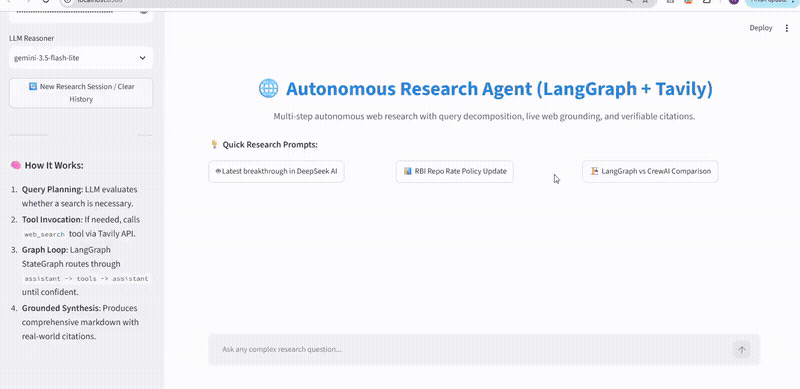

# Autonomous Web Research Agent (LangGraph + Tavily)

[](https://www.python.org/)
[](https://github.com/langchain-ai/langgraph)
[](https://tavily.com/)
[](https://ai.google.dev/)
[](https://streamlit.io/)

An autonomous multi-step research agent that executes dynamic query planning, web search tool invocation, hallucination verification, and structured synthesis with live verifiable citations.

---

## 📽️ Live Demonstration



> **High-Definition Video**: Full 85-second walkthrough is available at [`assets/demo.mp4`](assets/demo.mp4).

---

## ⚡ Key Capabilities

- **Autonomous Tool Calling**: Reasoner assesses queries, generates targeted multi-step web searches, and calls the Tavily Search API.
- **StateGraph Architecture**: Cyclical graph state (`assistant -> tools_condition -> tools -> assistant -> END`) ensuring verified grounding.
- **Transparent Execution Trace**: Interactive expander detailing exact intermediate search queries and latency.
- **Structured Executive Delivery**: Synthesis broken down into *Executive Summary*, *Detailed Analysis*, *Clickable Markdown Citations*, and *Key Strategic Takeaways*.

---

## 🏗️ State Machine Architecture

```
                    ┌─────────────────────────┐
                    │    User Research Prompt │
                    └────────────┬────────────┘
                                 │
                                 ▼
                     ┌───────────────────────┐
                     │   LangGraph State:    │
                     │  MemorySaver Thread   │
                     └───────────┬───────────┘
                                 │
                                 ▼
                     ┌───────────────────────┐
                     │    Assistant Node     │◄────────┐
                     │  (Gemini + Tool Bind) │         │
                     └───────────┬───────────┘         │
                                 │                     │
                    [tools_condition branch]           │
                     ┌───────────┴───────────┐         │
     Needs Web Info  │                       │ Confident
                     ▼                       ▼
           ┌───────────────────┐    ┌─────────────────┐
           │     Tool Node     │    │   Final State   │
           │  (Tavily Search)  │    │ (Markdown Synth)│
           └─────────┬─────────┘    └────────┬────────┘
                     │                       │
                     └───────────────────────┘
                                             │
                                             ▼
                                    ┌─────────────────┐
                                    │ Streamlit UI    │
                                    │ (Trace + Report)│
                                    └─────────────────┘
```

---

## 🚀 Quickstart

### 1. Environment Setup
```bash
python -m venv .venv
source .venv/bin/activate   # Windows: .venv\Scripts\activate
pip install -r requirements.txt
```

### 2. Configure API Keys
Create a `.env` file:
```env
GOOGLE_API_KEY=your_gemini_api_key
TAVILY_API_KEY=your_tavily_api_key
```

### 3. Run the Agent
```bash
streamlit run app.py
```
Open [http://localhost:8501](http://localhost:8501).

---

## 👤 Author

**Ramchandra Babar**  
*AI Engineer & Data Science Specialist*  
- Portfolio: [ram-portfolio-green.vercel.app](https://ram-portfolio-green.vercel.app/)  
- LinkedIn: [linkedin.com/in/rambabar](https://www.linkedin.com/in/rambabar)  
- GitHub: [@rambabar](https://github.com/rambabar)
